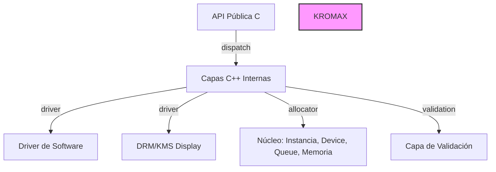

# Kromax: API Gráfica de Bajo Nivel

## Visión
Kromax es una API gráfica de bajo nivel inspirada en el diseño de Vulkan, que **no** depende de Vulkan, OpenGL, Mesa (ni libgbm/EGL), SDL ni GLFW. Habla directamente con el kernel de Linux (DRM/KMS) y trae un backend por software como referencia. Debe quedar profesional, escalable y listo para empezar a desarrollar sobre él.

### Estado
**Alpha** - La API pública y el driver de software están implementados, los ejemplos 00 y 01 se pueden compilar y ejecutar. La implementación interna C++20 tiene un problema de resolución de namespace `kx::std` con g++ 15.3.0 que necesita ser resuelto.

### ¿Por Qué Existe?
Para proporcionar una API estilo Vulkan que compile limpio tanto como C11 como C++20, sin dependencias externas de GPU, acceso directo al kernel para display, y un backend de software de referencia. Útil para aprender desarrollo de drivers de GPU, renderizado offline o como base para drivers de hardware personalizados.

### Características
- API pública en **C11** (C ABI estable), implementación interna en **C++20**
- Build: **CMake ≥ 3.24** con `CMakePresets.json`. Dependencia opcional de runtime: `libdrm` (solo para display KMS, detrás de una interfaz para poder reemplazarlo luego por ioctls directos)
- Tests: **doctest** vía FetchContent. Nada más.
- Sin excepciones ni RTTI cruzando el límite de la API. Errores con un tipo `kx::Expected<T>` propio (C++20 no tiene `std::expected`) y `KxResult` en la frontera.
- Plataforma inicial: **Linux**. Abstracción lista para otras plataformas, sin implementarlas.
- No se inventan detalles de hardware. El driver de GPU real queda como esqueleto deshabilitado (`KX_BUILD_DRIVER_AMDGPU=OFF`).

### Requisitos
- **Compilador**: GCC o Clang con soporte C++20
- **Opcional**: `libdrm` para backend display KMS
- **Herramientas de build**: `make`, `ninja` o build basado en CMake

### Inicio Rápido
1. **Compilar**:
   ```bash
   cd kromax
   cmake --preset debug
   cmake --build --preset debug
   ```

2. **Ejecutar primer ejemplo**:
   ```bash
   ./bin/00_enumerate
   ```

3. **Salida esperada**: Enumera el physical device de Kromax Software CPU

### Fragmento: Hola Mundo
```c
#include <kromax/kromax.h>

int main() {
    KxInstanceCreateInfo ici = {
        .sType = KX_STRUCTURE_TYPE_INSTANCE_CREATE_INFO,
        .pApplicationInfo = &(KxApplicationInfo){
            .sType = KX_STRUCTURE_TYPE_APPLICATION_INFO,
            .pApplicationName = "hello",
            .apiVersion = KX_API_VERSION_0_1,
        },
    };
    KxInstance instance;
    KX_CHECK(kxCreateInstance(&ici, NULL, &instance));
    // TODO: enumerar devices, crear device, etc.
    kxDestroyInstance(instance);
    return 0;
}
```

### Diagrama de Arquitectura (Mermaid)


### Cómo Contribuir
1. Hacer fork del repositorio
2. Crear una rama (`git checkout -b feature/xxx`)
3. Hacer commit siguiendo Conventional Commits: `git commit -m "feat: añadir nueva función"`
4. Push y abrir un Pull Request
5. Seguir el proceso ADR para decisiones de diseño

### Licencia
Copyright 2024-2025 Kromax GFX. Licenciado bajo ** Licencia Apache 2.0** (ver archivo LICENSE).