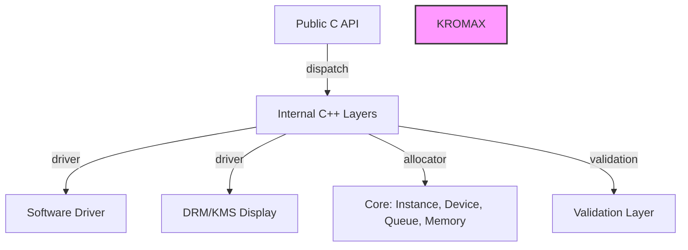

# Kromax: Low-Level Graphics API

## License

This project is licensed under **Apache License 2.0** - see the [LICENSE](LICENSE) file for details.

Copyright 2024-2025 Kromax GFX. All rights reserved.

...

### State
**Alpha** - Core API and software driver implemented, examples 00 and 01 compilable and runnable. Internal C++20 implementation has a `kx::std` namespace resolution issue with g++ 15.3.0 that needs to be solved.

### Why Does It Exist?
To provide a Vulkan-style API that compiles cleanly as both C11 and C++20, with no external GPU dependencies, direct kernel access for display, and a software reference backend. Useful for learning GPU driver development, offline rendering, or as a base for custom hardware drivers.

### Features
- Public API in **C11** (C ABI stable), internal implementation in **C++20**
- Build: **CMake ≥ 3.24** with `CMakePresets.json`. Optional runtime dependency: `libdrm` (only for KMS display, behind an interface for later replacement with direct ioctls)
- Tests: **doctest** via FetchContent. Nothing more.
- No exceptions or RTTI crossing the API boundary. Errors with custom `kx::Expected<T>` type and `KxResult` at the boundary.
- Initial platform: **Linux**. Abstraction ready for other platforms, not implemented.
- No hardware details invented. Real GPU driver remains as disabled skeleton (`KX_BUILD_DRIVER_AMDGPU=OFF`)

### Requirements
- **Compiler**: GCC or Clang supporting C++20
- **Optional**: `libdrm` for KMS display backend
- **Build tools**: `make`, `ninja`, or CMake-powered build

### Quick Start
1. **Build**:
   ```bash
   cd kromax
   cmake --preset debug
   cmake --build --preset debug
   ```

2. **Run first example**:
   ```bash
   ./bin/00_enumerate
   ```

3. **Expected output**: Enumerates the Kromax Software CPU physical device

### Snippet: Hello World
```c
#include <kromax/kromax.h>

int main() {
    KxInstanceCreateInfo ici = {
        .sType = KX_STRUCTURE_TYPE_INSTANCE_CREATE_INFO,
        .pApplicationInfo = &(KxApplicationInfo){
            .sType = KX_STRUCTURE_TYPE_APPLICATION_INFO,
            .pApplicationName = "hello",
            .apiVersion = KX_API_VERSION_0_1,
        },
    };
    KxInstance instance;
    KX_CHECK(kxCreateInstance(&ici, NULL, &instance));
    // TODO: enumerate devices, create device, etc.
    kxDestroyInstance(instance);
    return 0;
}
```

### Architecture Diagram (Mermaid)


### How to Contribute
1. Fork the repository
2. Create a branch (`git checkout -b feature/xxx`)
3. Commit following Conventional Commits: `git commit -m "feat: add new function"` 
4. Push and open a Pull Request
5. Follow the ADR process for design decisions

### License
Copyright 2024-2025 Kromax GFX. Licensed under **Apache License 2.0** (see LICENSE file).